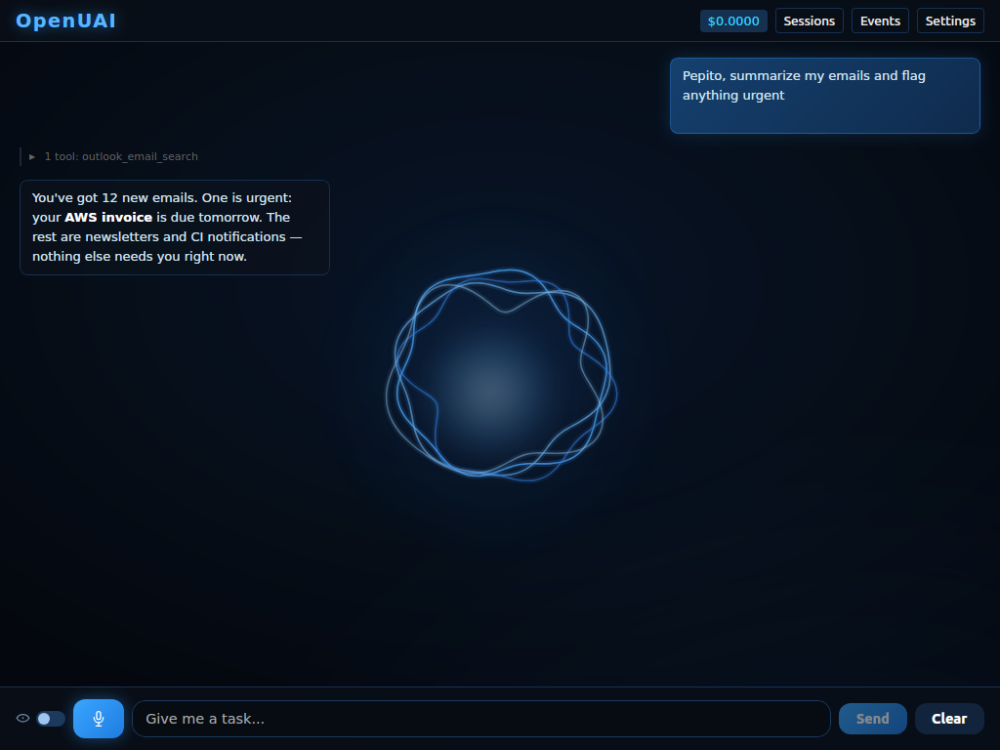

# OpenUAI — Open Unmanned Artificial Intelligence

> **[Website](https://openuai.pages.dev)** · **[Download](https://github.com/TLmaK0/openuai/releases/latest)** · **[Issues](https://github.com/TLmaK0/openuai/issues)**

Autonomous AI agent that reacts to events, executes tasks, and runs as a single binary on any OS. Full system access — file management, shell execution, git operations, web browsing, voice, and more.



## Features

- **Autonomous agent** — plan-first execution with full tool access: bash, filesystem, git, web
- **Event-driven** — subscribe to WhatsApp, Teams, email, webhooks; agent reacts automatically
- **Multi-agent** — spawn concurrent sub-agents for parallel task execution
- **MCP compatible** — connect to any MCP server to extend capabilities, and expose OpenUAI itself as an MCP server ([see below](#use-openuai-from-other-mcp-clients))
- **Marketplace** — one-click install of curated MCP servers from Settings
- **Voice** — hands-free wake word ("say a name, then your task"), push-to-talk Whisper STT (auto-detect language) + neural TTS
- **System tray** — background mode with native OS notifications
- **REST API** — run headless with 18 endpoints + WebSocket
- **Cost tracking** — real-time token usage and cost per request
- **Single binary** — no Docker, no Node, no Python. Download and run.

## Install

Download the latest binary from [Releases](https://github.com/TLmaK0/openuai/releases/latest) for your platform:

| Platform | Download |
|----------|----------|
| Linux amd64 | `openuai-linux-amd64` |
| Linux arm64 | `openuai-linux-arm64` |
| macOS universal | `openuai-macos-universal.zip` |
| Windows amd64 | `openuai-windows-amd64.exe` |

### Linux

Requires `libwebkit2gtk-4.1` (pre-installed on most desktop distributions):

```bash
# Ubuntu/Debian
sudo apt install libwebkit2gtk-4.1-0 libgtk-3-0

# Fedora
sudo dnf install webkit2gtk4.1 gtk3

# Arch
sudo pacman -S webkit2gtk-4.1 gtk3
```

### macOS

No additional dependencies. Uses native WKWebView.

### Windows

No additional dependencies. Uses WebView2 (included with Windows 10+).

## Development

Clone and run in one command:

```bash
git clone https://github.com/TLmaK0/openuai.git
cd openuai
./dev.sh
```

`dev.sh` installs system dependencies (webkit2gtk on Linux; Xcode Command Line Tools, Go and Node via Homebrew on macOS), installs the Wails CLI if missing, builds, and launches the app. It keeps running as a relaunch loop: when the app requests a restart (`POST /api/dev/restart`, optionally with a `worktree`) it is rebuilt and launched again. Use `./dev.sh --once` to build and run a single time.

### Manual build

```bash
# Install Wails CLI
go install github.com/wailsapp/wails/v2/cmd/wails@latest

# Linux (Ubuntu/Debian with webkit2gtk-4.0)
wails build -tags webkit2_40

# Linux (webkit2gtk-4.1) / macOS / Windows
wails build
```

## Use OpenUAI from other MCP clients

OpenUAI is also an MCP **server**: Claude Code, Claude Desktop or any other MCP
client can hand tasks to the running app.

**Tools exposed**

| Tool | What it does |
|------|--------------|
| `send_message` | Sends a message or task to the assistant and waits for its final answer |
| `get_conversation` | Reads the current conversation (last `limit` entries, default 20) |
| `new_conversation` | Archives the current conversation and starts a new one |
| `stop_task` | Stops the task the assistant is running |
| `get_status` | Provider, model, working folder and accumulated tokens/cost |

A `send_message` call runs exactly like a message typed in the chat: same
conversation, tools, connectors, memory, hooks and skills. **Permissions are not
bypassed**: when a tool needs approval, the usual dialog shows up in the
OpenUAI window and the call waits for your answer there. Messages are run one
at a time, after whatever the assistant is already doing.

**Enable it.** The MCP endpoint lives on the local API, which is off by default.
Set in `config.json` in the OpenUAI config folder (`~/.config/openuai` on Linux,
`~/Library/Application Support/openuai` on macOS, `%AppData%\openuai` on Windows)
and restart OpenUAI:

```json
{ "api_enabled": true, "api_port": 9120 }
```

The API only listens on `127.0.0.1`, and the MCP endpoint rejects requests
whose `Host` or `Origin` is not local (so web pages cannot reach it).

**Two transports, same tools:**

- Streamable HTTP: `http://127.0.0.1:9120/mcp` (served by the running app).
- stdio: `openuai mcp`, a small proxy to that endpoint for clients that launch
  MCP servers as commands. It reads `api_port` from the config
  (`--port N` or `--url URL` override it). OpenUAI must be running.

**Claude Code**

```bash
# HTTP (recommended)
claude mcp add --transport http openuai http://127.0.0.1:9120/mcp
# or stdio
claude mcp add openuai -- /path/to/openuai mcp
```

Tasks can take minutes; raise Claude Code's tool timeout if needed, e.g.
`MCP_TOOL_TIMEOUT=600000 claude` (milliseconds). While a task runs, OpenUAI
sends progress notifications every 10 seconds.

**Claude Desktop** — add to `claude_desktop_config.json` (Settings → Developer →
Edit Config) and restart Claude Desktop:

```json
{
  "mcpServers": {
    "openuai": {
      "command": "/path/to/openuai",
      "args": ["mcp"]
    }
  }
}
```

On macOS the binary is `/Applications/openuai.app/Contents/MacOS/openuai`
(or wherever you put the app); on Windows use the full path of
`openuai-windows-amd64.exe`.

## Architecture

```
┌──────────────────────────────────────────────────────────────┐
│                    openuai (single binary)                    │
│                                                              │
│  [Event Sources]        [Engine]            [Actions]        │
│   WhatsApp ──┐                             ┌── Filesystem    │
│   Email ─────┤                             ├── Reply         │
│   Webhooks ──┤                             ├── Bash/Git      │
│   Teams ─────┼→ Event Bus → LLM ────┐     ├── APIs          │
│   Slack ─────┤              Agent   ├→ Agent├── Voice Out    │
│   Cron ──────┤                      │      └── Notify        │
│   Clipboard ─┘                      │                        │
│                                     ├→ Sub-Agent (parallel)  │
│                                     └→ Sub-Agent (parallel)  │
│                                                              │
│  [System Tray]  [Embedded UI]  [LLM Client]  [Cost Tracker] │
│  [Memory]       [MCP Client/Server]  [REST API]  [Voice In] │
└──────────────────────────────────────────────────────────────┘
```

## Disclaimer

> **USE AT YOUR OWN RISK.** This software is provided "as is", without warranty of any kind, express or implied. The authors and contributors are not responsible for any damage, data loss, security issues, costs incurred (including LLM API charges), or any other consequences resulting from the use of this software. This software can execute arbitrary commands on your system, access files, and interact with external services — it is your responsibility to review and approve actions before they are executed. By using this software, you accept full responsibility for its use.

## License

[Commons Clause + MIT](LICENSE): free to use, modify and redistribute under the MIT terms, but you may not sell the software or a service whose value derives substantially from it. See [LICENSE](LICENSE) for the full text.
